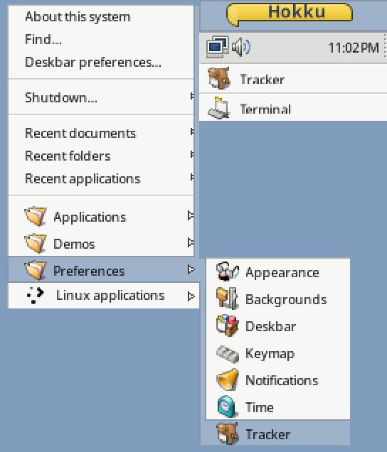
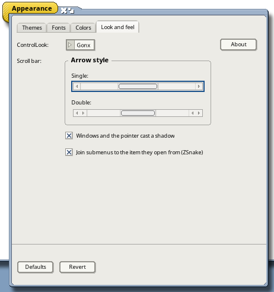

<div align="center">

# Hokku

**Be and Haiku apps as ordinary programs on Linux, on X11 and Wayland.**

[](https://github.com/idumych/hokku/actions/workflows/build.yml)
[](https://github.com/idumych/hokku/actions/workflows/appimage.yml)
[](License.md)

[What it adds](#what-it-adds) · [Screenshots](#screenshots) · [Apps](#apps-built-on-hokku) · [Building](#building) · [Your app](#using-it-in-your-app) · [What's missing](#whats-missing) · [All changes](docs/changes-from-cosmoe.md)


</div>

Hokku is a fork of [Cosmoe](https://github.com/haydentech/cosmoe), the BeOS/Haiku API as a
C++ library. It runs Be and Haiku apps as ordinary programs on Linux, behaving as closely to
Haiku as it can. A *hokku* is the opening verse of a linked poem, the verse the haiku grew
out of.

## Why this fork exists

- **AI-assisted fixes have a home here.** Each fix is reviewed and tested against real apps
  before it lands. Cosmoe doesn't accept AI contributions, so they live in this fork.
- **A library to build freestanding app ports against.** Renku OS and Haiku apps build
  against it to run on Linux as standalone programs, such as AppImages.
- **In the spirit of [Renku](https://github.com/RenkuOS/Source)**, the Haiku fork that
  welcomes machine-assisted work.

Hokku follows upstream Cosmoe and merges its changes regularly. The library names, headers
and build are unchanged, so anything that builds against Cosmoe builds against Hokku.

## What it adds

<table>
<tr>
<td width="50%" valign="top">

**Haiku apps build as they are**

Shared areas between processes, fair semaphores, a working node monitor, `BGLView`, `BNetworkRoute`, the public `BAboutWindow`, and `-lmedia`, `-ltranslation` and `-lnetwork` for unchanged Haiku Makefiles.

</td>
<td width="50%" valign="top">

**Queries and attributes on Linux**

`BQuery` works, live queries included, so Tracker's Find window follows the files. Attributes can be any size on file systems that allow it, and `watch_volume()` is there.

</td>
</tr>
<tr>
<td width="50%" valign="top">

**Drawing like app_server**

Pixel-exact lines and polygons, Haiku's transfer modes and bitmap transparency, underline and strikeout, rotated text, and fonts chosen as Haiku chooses them.

</td>
<td width="50%" valign="top">

**Audio through the Media Kit**

`BMediaFile` and `BSoundPlayer` play WAV, MP3, FLAC and Ogg Vorbis.

</td>
</tr>
<tr>
<td width="50%" valign="top">

**A Deskbar at home on Linux**

Apps' own Deskbar replicants, the desktop's tray icons with their menus, a brightness control on laptops, a menu of your Linux applications, and shared recent documents. In Plasma, GNOME or sway, an app's Deskbar item can sit in the desktop's own tray instead.

</td>
<td width="50%" valign="top">

**Notifications, the Haiku way**

Haiku's `notification_server` and preferences, also showing other Linux apps' notifications, with action buttons.

</td>
</tr>
<tr>
<td width="50%" valign="top">

**Themes for the whole desktop**

Haiku's look or [Gonx](https://github.com/idumych/gonx) in one step: window frame, controls, colours, fonts, wallpaper, shadows and the BeOS pointer, carried over to GTK 3 and Qt apps too.

</td>
<td width="50%" valign="top">

**BeOS Dano's ZSnake**

The hidden menu effect of the unreleased BeOS 5.1, where a submenu's selection joins the item it opened from.

</td>
</tr>
<tr>
<td width="50%" valign="top">

**Wayland and touch**

Client-side window frames drawn by Haiku's own decorators, add-ons included, with rounded corners and a shadow, or a glow on a dark desktop; borderless windows that move themselves, menus the compositor places, and touch screens.

</td>
<td width="50%" valign="top">

**A desktop session beside others**

"Hokku" on the login screen next to Plasma or GNOME, without cluttering their menus. [Hokku OS](https://github.com/idumych/hokku-os) is a CachyOS respin with it as the desktop.

</td>
</tr>
</table>

Every change, with the details and what was tested, is in
[All changes from Cosmoe](docs/changes-from-cosmoe.md).

## Screenshots

<table>
<tr>
<td width="50%" align="center"><br><sub>Haiku's look on Hokku OS</sub></td>
<td width="50%" align="center"><br><sub>Gonx, applied to the same Hokku, GTK 3 and Qt 6 apps</sub></td>
</tr>
<tr>
<td align="center"><br><sub>Notifications beside the Deskbar, with action buttons</sub></td>
<td align="center"><br><sub>The desktop's tray icons in the Deskbar</sub></td>
</tr>
<tr>
<td align="center"><br><sub>ZSnake in the Deskbar</sub></td>
<td align="center"><br><sub>The switch for it in Appearance</sub></td>
</tr>
</table>

<details>
<summary>More screenshots</summary>

The Deskbar: a tray icon's menu sent over D-Bus, and the Linux applications menu.


The Notifications preferences:


The same apps before and after `gonx-theme apply`, and Gonx close-ups: tabs, controls, a
menu and an alert.


The Gonx controls in Hokku, GTK 3 and Qt (Kvantum):

| Hokku | GTK 3 | Qt (Kvantum) |
|---|---|---|
|  |  |  |

Haiku's window frame, AboutSystem, and GLTeapot through `BGLView`:


</details>

## Apps built on Hokku

Shipped on Linux with Hokku; each also runs on Renku OS and Haiku.

| App | What it is |
|---|---|
| [Sheath](https://github.com/idumych/sheath) | A SWORD Bible reader (the first). |
| [Folio](https://github.com/idumych/folio) | A notebook with wiki links that follow renames. |
| [Gobe Productive](https://github.com/idumych/gobe-productive) | The BeOS office suite, ported from the original. The largest so far. |
| [VLC Reborn](https://github.com/idumych/vlc-reborn) | VLC media player with its BeOS interface back. |
| [LinShare](https://github.com/idumych/linshare) | A Linux port of atomozero's [HiShare](https://github.com/atomozero/HiShare), the modernized BeShare file-sharing and chat client. |
| [PowerPlay](https://github.com/idumych/powerplay) | An audio player in the spirit of SoundPlay, with Winamp skins, a library window and a VU meter in the Deskbar or the desktop's tray. |
| [BeSame](https://github.com/idumych/besame) | A ball-removing puzzle ported from BeOS. |
| [EasyPaint](https://github.com/idumych/EasyPaint) | A simple bitmap editor. |

Each brought fixes with it; they are listed in [All changes from Cosmoe](docs/changes-from-cosmoe.md).

## Building

Hokku has no packages or releases of its own yet, so you build it from this repository.
Its changes are made and tested on Linux. The macOS and Windows builds are upstream
Cosmoe's: their steps below are upstream's, and they aren't tried with Hokku.

### Linux

You need gcc or clang, meson and ninja, bison and flex, and the development files of
libpng, ICU, FreeType, Pango, fontconfig, GLib, Wayland, pixman, xkbcommon (with its X11
part) and cairo. libjpeg, libwebp, libtiff, libraw and libicns are optional; without them
the matching image translators aren't built. For SVG tray icons add librsvg, and for
`BGLView` EGL and the OpenGL headers.

<details>
<summary>Install them on Ubuntu or Debian</summary>

```bash
sudo apt install gcc g++ flex bison libpng-dev libjpeg-dev libwebp-dev libtiff-dev libraw-dev libicns-dev libicu-dev libfreetype6-dev libpango1.0-dev libpixman-1-dev libxkbcommon-dev libwayland-dev pkg-config meson libxkbcommon-x11-dev libxcursor-dev libxrandr-dev libfuse3-dev libx11-xcb-dev librsvg2-dev libegl-dev libgl-dev
```

</details>

<details>
<summary>Install them on Fedora</summary>

```bash
sudo dnf install gcc g++ flex bison libpng-devel libjpeg-devel libwebp-devel libtiff-devel libraw-devel libicns-devel libicu-devel freetype-devel pango-devel libxkbcommon-devel wayland-devel meson libxkbcommon-x11-devel libXcursor-devel libXrandr-devel fuse3-devel libX11-devel librsvg2-devel mesa-libEGL-devel mesa-libGL-devel
```

</details>

<details>
<summary>Install them on Arch Linux</summary>

```bash
sudo pacman -S python meson pkg-config libwebp libtiff libraw libicns gcc binutils make flex bison librsvg
```

</details>

Then:

```bash
make
make install
```

The build goes into `builddir`, and programs are installed to `/usr/local/bin`.

| To get | Do this |
|---|---|
| Your own packages | `make deb` on Debian or Ubuntu, `make rpm` on Fedora |
| Hokku without its apps, to bundle with one app | `meson setup builddir -Denable_apps=false` |
| An AppImage of one of Hokku's own apps | `packaging/appimage/build-appimage.sh APP` |
| Old XEmbed tray icons | Install `xembedsniproxy` (part of Plasma) or `snixembed` |

<details>
<summary><strong>macOS</strong></summary>

Install the Xcode command line tools (`xcode-select --install`) and
[Homebrew](https://brew.sh/), then:

```bash
brew install meson ninja pkg-config cairo pango libpng jpeg-turbo webp icu4c freetype fontconfig glib
make
make install
```

The build needs a case-sensitive volume, so `make` creates a disk image and builds there
(you may see it mounted in the Finder). Command-line programs go to `/usr/local/bin`,
graphical programs to `/usr/local/Applications` and fonts to `~/Library/Fonts/Cosmoe`.

</details>

<details>
<summary><strong>Windows</strong></summary>

Windows is cross-compiled on Linux or WSL, and runs on Windows or under Wine.

```bash
make windows-mingw
```

This downloads the MinGW-w64 toolchain and the libraries it needs, builds everything and
gathers the executables and DLLs into `win-test-mingw`. The older MXE route, `make windows`,
is still there and needs [MXE](https://mxe.cc/) set up first (`cross-mxe.ini` has its paths).

</details>

## Running the apps

Apps start from the command line or from your desktop's launcher. The build includes:

- **The desktop:** Tracker and the Deskbar.
- **Apps:** Terminal, StyledEdit, ShowImage, DeskCalc, Clock, Pulse, CharacterMap, Icon-O-Matic,
  ResEdit, DiskUsage, Chart, Columns, FontDemo, Gradients, Mandelbrot, GLTeapot (with OpenGL), Pairs,
  Sudoku, Showcase and AboutSystem.
- **Preferences:** Appearance, Backgrounds, Deskbar, Keymap, Notifications, Time and Tracker.

Not all of them behave exactly as on Haiku yet. Showcase is the testbed for new API work, and
the best example of what the library can do.

For a whole BeOS-style desktop without logging out, install labwc and run
`./start_cosmoe_desktop.sh`. To have it on the login screen, `make install` adds a Hokku session.

## Using it in your app

The API reference is the [Haiku Book](https://www.haiku-os.org/docs/api/) and the BeBook.

The app templates in [beos-app-platforms](https://github.com/idumych/beos-app-platforms)
build their AppImages (x86_64 and aarch64) against Hokku's `hokku` branch by default; an
app's `haiku-app.env` can point `COSMOE_REPO` and `COSMOE_TAG` at another fork or tag. CI
caches the build by the commit the branch points at, so a new Hokku commit is picked up on
the next build.

An app that also builds for Haiku puts Hokku-only calls (such as `BNotification`'s actions)
under `#ifdef APP_COSMOE`.

Some things work differently from Haiku. `entry_ref::name` is a full path here, so use
`BPath(&ref).Leaf()` or `BEntry::GetName()`, which work on both.

## What's missing

- **Drag and drop** from other programs doesn't work yet.
- **Printing, `BWindowStack`** and some other APIs are stubs. [TODO.md](TODO.md) has the list.
- **Media Kit:** no audio writing, no video and no Opus.
- **`BNetworkInterface` and `BNetworkRoster`** aren't there yet.
- **Queries:** `fs_open_query()` and its relatives aren't there yet, and `BQuery` is Linux only.
- **X11** doesn't get Hokku's window frames, as the window manager draws them.
- **GTK 4 and libadwaita apps** keep their own look.

## Problems

Problems found with Hokku are fixed here, as new commits on `hokku`, with the smallest
program that shows the bug used to test the fix. Please don't report them to upstream
Cosmoe: it doesn't take AI-assisted work, and the bug may be one Hokku introduced or already
fixed.

## Licence and thanks

MIT, as upstream. See [License.md](License.md).

Thanks to Bill Hayden and the Cosmoe contributors, who brought the Haiku API to other systems,
and to the Haiku project, whose work made both possible.
