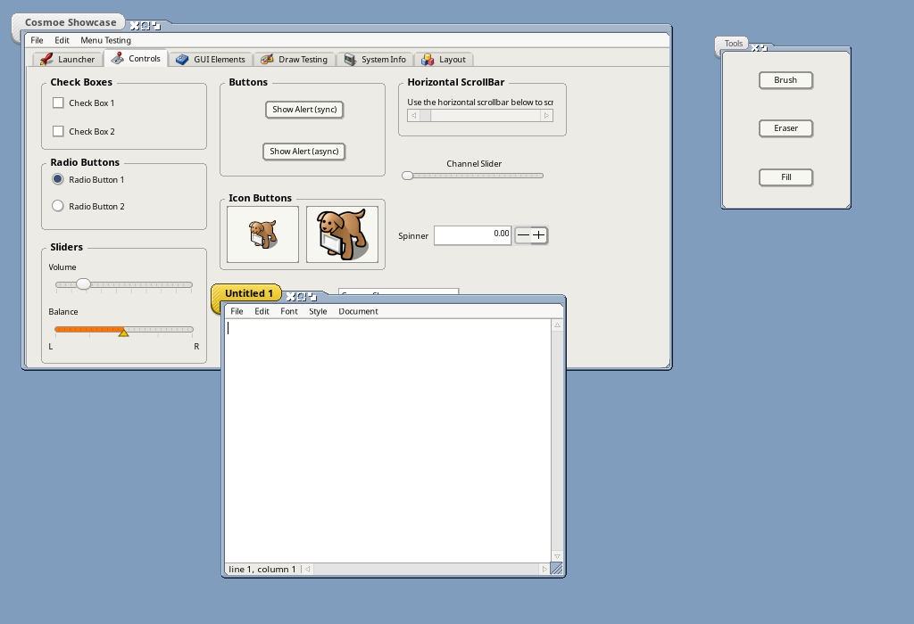
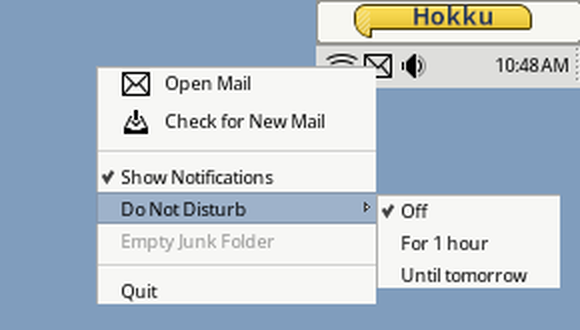
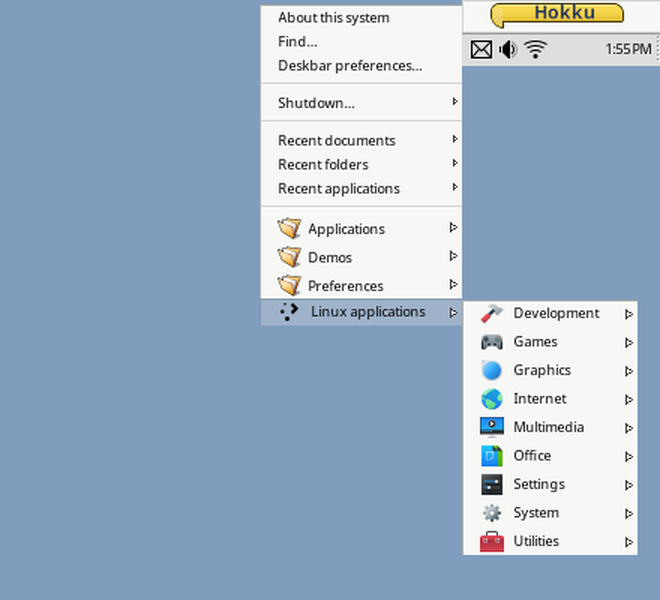
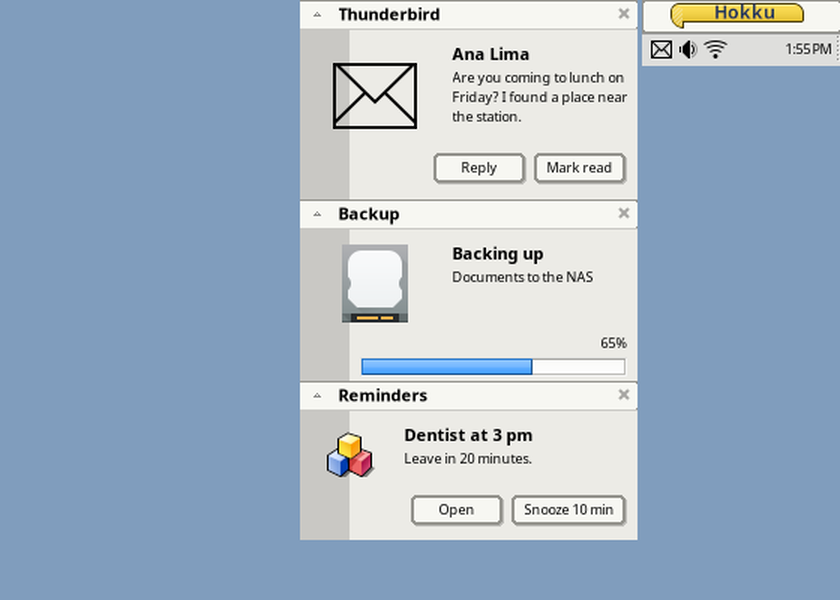
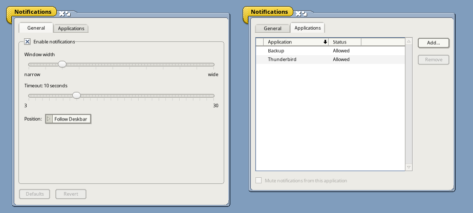
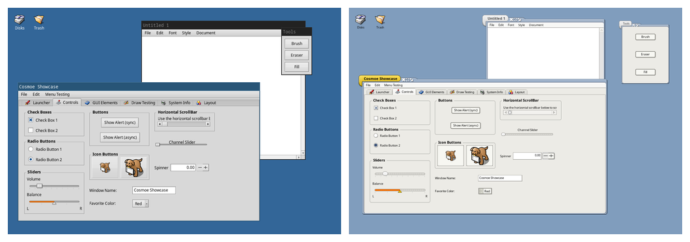
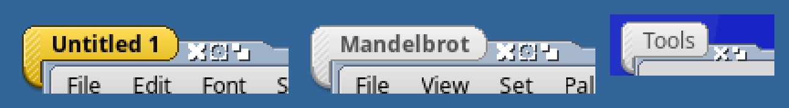
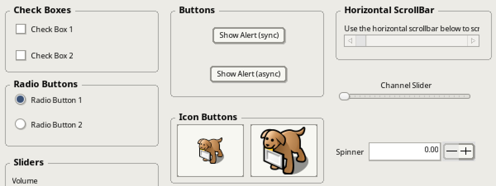
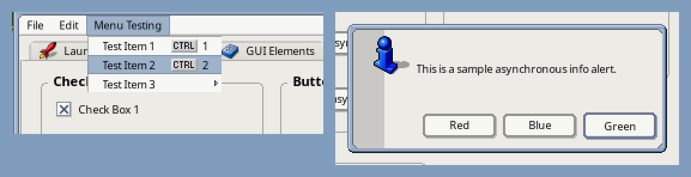
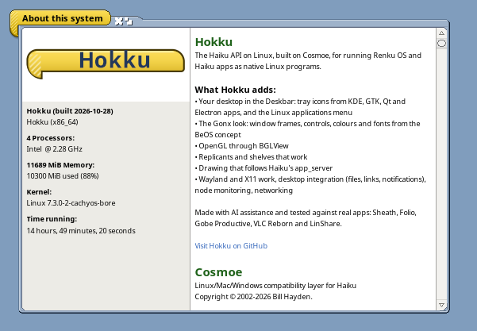

# Hokku

Hokku is a fork of [Cosmoe](https://github.com/haydentech/cosmoe), the BeOS/Haiku API as a
C++ library for Linux (X11 and Wayland), macOS and Windows. A *hokku* is the opening verse
of a linked poem, the verse the haiku grew out of.



## Why this fork exists

- **AI-generated fixes have a home here.** Hokku incorporates fixes written with AI
  assistance. Each fix is reviewed and tested against real apps before it lands. Cosmoe
  doesn't accept AI contributions, so these fixes are kept in this fork instead of being
  proposed upstream.
- **A library to build freestanding app ports against.** The focus is narrow: a stable
  Haiku API that Renku OS and Haiku apps can be built against to run on Linux as
  standalone, freestanding programs (for example AppImages), with behaviour that matches
  Haiku as closely as possible.
- **Started in the spirit of [Renku](https://github.com/RenkuOS/Source).** Renku OS is a
  Haiku fork that welcomes machine-assisted work. Hokku brings that approach to the library
  that carries Renku and Haiku apps to other systems.

Hokku follows upstream Cosmoe and merges its changes regularly. The library names, headers
and build (`meson`, `libbe.so` and friends) are unchanged, so anything that builds against
Cosmoe builds against Hokku. Licence: MIT, as upstream (see License.md).

## Highlights

### The desktop's tray icons, in the Deskbar

On Linux, Deskbar shows the tray icons of the desktop's other apps, as the Plasma and Xfce
panels do: KDE and Qt apps, GTK apps using libappindicator or libayatana-appindicator,
Electron apps (Signal, Slack...), VPN clients, update notifiers. Deskbar starts `TrayBridge`
(`src/apps/traybridge`), a StatusNotifierItem host, which puts each icon in the tray as a
replicant.




- **Clicks go back to the app.** A click activates it, a middle click is its secondary
  action, the wheel scrolls (a volume icon's, say), and a right click opens the app's own
  menu (`com.canonical.dbusmenu`) with its icons, checkmarks, radio items, submenus and
  disabled entries. The app hears when the menu opens and closes, with a choice or without.
- **Changes come in live:** icon, attention, overlay, tooltip and status. Passive icons are
  hidden, as Plasma hides them; `HOKKU_TRAY_SHOW_PASSIVE=1` shows them.
- **Icons look like the desktop's.** They come from the app's pixmaps or from the icon
  theme: KDE's, GNOME's or GTK's setting, Breeze in a Plasma session that hasn't changed
  it, or `HOKKU_ICON_THEME`. SVG icons are drawn with librsvg when it's installed, and KDE's
  symbolic icons take the system colours, as Plasma gives them its own.
- **It works next to another panel.** On a desktop that already has a tray (Plasma, Xfce),
  TrayBridge registers with that desktop's StatusNotifierWatcher as one more host, so the
  icons are in both trays. Elsewhere it is the watcher.
- **Old XEmbed icons** (Wine, older GTK 2 and Java apps) come through `xembedsniproxy` or
  `snixembed` when one is installed (`HOKKU_TRAY_XEMBED=0` to skip).
- **Starting and restarting.** Deskbar starts TrayBridge unless `HOKKU_TRAYBRIDGE=0`. A
  Deskbar started again finds TrayBridge still running, and it adds its icons to the new
  tray.

Tested in a Plasma 6 Wayland session (next to IVPN's and the CachyOS update notifier's
icons), on X11 and on sway. The screenshots show a scripted test item, on sway with the
Gonx look.

The Deskbar menu has the desktop's applications too: **Linux applications** lists every
`.desktop` file in the XDG data folders that the desktop itself would show (honouring
`NoDisplay`, `Hidden`, `OnlyShowIn`/`NotShowIn` and `TryExec`, with your own files
overriding the system's), in submenus by freedesktop main category, with their icons.
Choosing one starts it through GIO as the desktop's launcher does. The list is read again
when an applications folder changes.



It needed four fixes in the kits, which every app gets:

- **`BShelf` works again.** Cosmoe had replaced Haiku's `BShelf` with empty stubs
  (`AddReplicant()` always failed), so no shelf, the Deskbar's tray included, could hold a
  replicant; the likely reason was that its `<AutoLock.h>` collides with `<Autolock.h>` on
  macOS's case-insensitive file system. Haiku's implementation is back, using
  `<AutoLocker.h>`.
- **A removed view is repainted over.** With no app_server, nothing redrew the area a view
  left when it was removed, so it stayed on screen; `BView::RemoveChild()` now invalidates
  it.
- **Apps without windows are seen.** `BRoster::GetAppInfo()` and `IsRunning()` find a
  running app that has no window through the messenger every app registers, and
  `BMessenger::IsValid()` is true for a messenger into another running app (ports are per
  process here). `GetAppList()` lists those apps too, with the signature they registered,
  so `hey` reaches the Deskbar, Tracker's desktop and the servers (`hey Deskbar BeMn`
  opens the Deskbar menu).
- **`BDeskbar::AddItem()` returns Deskbar's error** instead of `B_NAME_NOT_FOUND`.

### Notifications, the Haiku way

Haiku's `notification_server` is here, with its Notifications preferences. The Deskbar
starts it on Linux (`HOKKU_NOTIFICATIONS=0` leaves it off), and notifications appear as on
Haiku, beside the Deskbar: grouped by app under a header with a close button, with icons,
progress bars, and the important type marked; they time out, and update in place when sent
again with the same ID.



- **Hokku apps:** `BNotification::Send()` goes to it when it runs, as on Haiku, and to the
  desktop's notifications (`notify-send`) when it doesn't. A Hokku extension gives them
  buttons: `AddAction(label, message[, target])` adds one, and clicking it sends the
  message to the target (the app by default) and closes the notification;
  `CountActions()`, `ActionLabelAt()`, `ActionMessageAt()` and `ActionTargetAt()` read
  them. The class keeps its size: the actions live outside it, in its reserved room. The
  same API is proposed to Renku OS
  ([RenkuOS/Source#233](https://github.com/RenkuOS/Source/pull/233)); until it lands
  there, an app that also builds for Renku or Haiku puts these calls under
  `#ifdef APP_COSMOE`, with an `OnClick*()` launch as the fallback.
- **The desktop's apps:** it serves `org.freedesktop.Notifications` on the session bus
  when no other notification server does, as on a desktop of Hokku apps; under Plasma or
  GNOME their own popups keep the desktop's apps (it takes over if they ever stop). A
  Linux app's icon, image or icon name is its icon, critical urgency is the important
  type, a progress hint is a progress bar, a replacement ID updates the notification, a
  click is the app's default action, its other actions are a row of buttons under the text
  (Reply, Mark read...), and the app hears why a notification closed (expired, dismissed,
  or closed by the app).
- **The preferences** (Notifications, in the Deskbar's Preferences): turn notifications
  on or off, their width, timeout and position, and mute any app. Changes apply at once.
  Every app that sent one is listed, the desktop's apps too, which Haiku's list (apps
  added from a file panel) couldn't hold.



On Wayland, where windows can't place themselves, the notification window is a corner
panel that keeps the distance to its corner it is moved to (see Wayland below).

### Touch screens

On Wayland, Hokku apps work with a finger: a tap is a click, a drag is a drag (through
menus and into their submenus too), and a long press is a right click, which opens a tray
icon's menu or a context menu. Tested on a touch screen in Plasma; the details are under
Wayland below.

### The Gonx look

Hokku can take on the whole [Gonx](https://github.com/idumych/gonx) look, the BeOS concept
theme made for Renku OS: its window frame, its controls, and its colours, fonts and desktop
colour. Run `gonx-theme apply` to switch to it and `gonx-theme revert` to go back to what was
there before; apps started afterwards use it.

The same apps before and after `gonx-theme apply` (left: Hokku's own look, with sway's title
bars; right: Gonx):



Close-ups: the tabs of an active, an inactive and a floating window; the controls; a menu,
and an alert in the Gonx border.







- **Window frame.** Titled, document and floating windows get the Gonx tab, flap and
  rounded corners on Wayland, and modal windows (alerts) the Gonx border without a tab,
  moved by dragging the border. The frame is drawn client-side, so the compositor leaves
  its own title bar off (tested on sway; KDE honours the same request but hasn't been
  tried). On X11 the window manager draws frames. `setdecor Gonx` and `setdecor Default`
  switch only the frame. Standalone apps run from their AppImage keep the desktop's own
  frames (Hokku's default frame where the compositor draws none), while taking the rest of
  the look; apps they start don't count, as their executable isn't in the AppImage.
- **Controls.** `GonxControlLook.so`, a control look add-on like the Be, Flat and dark ones,
  draws buttons, check boxes, sliders, scroll bars and tabs. It is the same code as the
  Renku add-on; `setcontrollook` can choose it on its own.
- **Deskbar and About.** The Deskbar's menu button shows a small Gonx tab with "Hokku" on
  it instead of the Cosmoe rocket, and AboutSystem shows it large
  (`src/apps/deskbar/gonx-logo.py` draws it), with what Hokku adds to Cosmoe.

  
- **Colours, fonts, desktop.** `gonx-theme` sets them through the usual Haiku calls, which
  Hokku now keeps (see Desktop integration below). The fonts are Noto Sans at 9 and 11 points.

### OpenGL with `BGLView`

Hokku has the OpenGL kit's `BGLView` (`libopengl.so`, header `<opengl/GLView.h>`, the same
API as Haiku's): `LockGL()`, `UnlockGL()`, `SwapBuffers()` and `GetGLProcAddress()`, from
any thread, as on Haiku. It renders with EGL (Mesa's surfaceless platform when there is one,
otherwise the default display, so NVIDIA's driver works too) into an off-screen buffer the
size of the view; `SwapBuffers()` copies the frame into a bitmap that the view draws, on X11
and Wayland alike. It's built when EGL and `GL/gl.h` are found (Debian/Ubuntu: `libegl-dev
libgl-dev`). `CopyPixelsIn()`/`Out()`, overlays and `BGLScreen` aren't there yet. VLC
Reborn's OpenGL video output uses it.

### Apps built on Hokku

Apps shipped on Linux with Hokku (each also runs on Renku OS and Haiku, LinShare as HiShare):

- [Sheath](https://github.com/idumych/sheath), a SWORD Bible reader (the first).
- [Folio](https://github.com/idumych/folio), a notebook with wiki links that follow renames.
- [Gobe Productive](https://github.com/idumych/gobe-productive), the BeOS office suite
  ported from the original (a preview of its word processor). It is the largest so far,
  and found the Wayland crash listed below: an alert as an app's first window.
- [VLC Reborn](https://github.com/idumych/vlc-reborn), VLC media player with its BeOS
  interface back. It brought `BGLView` (for its OpenGL video output) and found the Wayland
  menu placement bug.
- [LinShare](https://github.com/idumych/linshare), atomozero's
  [HiShare](https://github.com/atomozero/HiShare) (the modernized BeShare file-sharing and
  chat client) for Linux. A network app with old Be code in it, it brought `BNetworkRoute`,
  screen capture, `BDirectory(node_ref)`, `Launch()` through `xdg-open` and the `<Debug.h>`
  helpers, and found the shell injection in notifications and the unlocked view lookups on
  the display thread (once `debugger()` printed).

## All changes from Cosmoe

### Drawing

- **Font styles chosen like Haiku.** Styles lighter than Book get `B_LIGHT_FACE`, Black and
  Heavy get `B_HEAVY_FACE`, condensed widths `B_CONDENSED_FACE`, and when several styles share
  a face the canonical one wins. Before, every weight below Bold counted as regular and the
  first match was used, so `SetFamilyAndFace("Noto Serif", B_REGULAR_FACE)` drew Thin.
- **Underline and strikeout are drawn.** `B_UNDERSCORE_FACE` and `B_STRIKEOUT_FACE` stay in
  the font's face and are drawn by `DrawString()`, so `BTextView` runs show them.
- **Views moved by a layout are redrawn whole.** `Invalidate()` lists a view's children for
  the update when it is called, but a layout pass could move them before the update ran: a
  child that moved into the invalid area wasn't drawn, and one that moved within it only in
  part. Windows that the window manager placed or sized differently from what they asked for
  could show half-drawn buttons and remnants of earlier frames until resized. The update now
  takes the children from their current frames.
- **A resize can't leave a window's last drawing off screen.** Resizing recreates a window's
  backing surface, dirty all over, without asking the backend to copy it; on X11 the backend's
  own redraw for the resize could run first, with the old surface. The window then kept
  showing its earlier content (a status line that had changed) until something else drew,
  such as the mouse moving over it. The window now asks for a redraw when the surface changes.
- **The text caret blinks under the backing-surface lock.** `InvertRect()`, which the caret
  uses from `Pulse()` outside any update, drew into the window's backing surface without the
  lock the backend holds while copying it to the screen, so a copy could catch the inversion
  halfway. It now holds the lock while it draws and marks the area dirty.
- **`B_OP_MIN` and `B_OP_MAX` compare brightness.** Like app_server, a pixel takes the
  drawing's colour only where that is darker (MIN) or brighter (MAX) as a whole, judged by
  brightness. Cairo's DARKEN and LIGHTEN, used before, compare each channel on its own, so a
  gray wash over a red icon (how many BeOS apps grey out a disabled button) gave pink.
- **Lines, rects and polygons sit on the pixels app_server uses.** Unless a view is
  `B_SUBPIXEL_PRECISE`, coordinates are rounded down to whole pixels; an even pen size is
  centred on the pixel edge, so a line of pen size 2 covers two whole rows instead of a
  blurred three; lines thicker than 1 get the butt caps they ask for; and the points of a
  filled polygon are pixel corners. Triangles, filled or not, go through pixel centers, as
  in app_server.
- **Patterns leave their low color out in `B_OP_OVER`.** A pattern's transparent pixels were
  stored with their color but no alpha, which Cairo (premultiplied) adds to what's
  underneath: a stipple filled over text painted the low color (often the 0x777477 of
  `B_TRANSPARENT_32_BIT`) between its dots. The pattern's pixels are now premultiplied.
- **8-bit and 32-bit bitmaps are transparent where Haiku's are.** Outside `B_OP_COPY`,
  `B_TRANSPARENT_MAGIC_CMAP8` pixels of a `B_CMAP8` bitmap and `B_TRANSPARENT_MAGIC_RGBA32`
  pixels of a `B_RGB32` bitmap are left out, and `B_OP_ALPHA` uses a `B_RGB32` bitmap's alpha
  bytes. Before, icons drawn with `B_OP_OVER` showed a white box where they should be clear.
- **A view bitmap's `Bits()` and its views' drawing stay in step.** On Haiku they are the same
  memory; here a `B_BITMAP_ACCEPTS_VIEWS` bitmap's views draw into a separate surface. Every
  `Bits()` call copied that surface over the bits, and `DrawBitmap()` drew the surface, so
  pixels an app wrote through `Bits()` (a fill, a pasted image, a freshly cleared canvas) were
  lost unless it locked the bitmap in between. The bitmap now tracks which copy changed: the
  bits go to the surface on `Lock()` or before the bitmap is drawn, and come back only if the
  views may have drawn. Test: `src/tests/kits/interface/bbitmap/BitmapBitsSyncTest`.

### Windows, menus and input

- **Opening a menu doesn't read the menu bar unlocked.** To avoid a deadlock on Windows, a
  menu bar unlocks its window while a menu opens, but opening the menu still read the menu
  bar's position (`Bounds()`, `ConvertToScreen()`, `ScreenLocation()`) from the tracking
  thread: a race, and a `debugger("Looper must be locked")` with a backtrace every time a
  menu opened. Those reads now take the menu bar's window lock briefly.
- **Pointer events don't walk an unlocked window.** The display thread looked up the view
  under the pointer (for every motion, click, wheel and idle event) without the window's
  lock, racing the window thread and calling `debugger("Looper must be locked")` on every
  `BView::Bounds()`. It now takes the lock only if it is free; when the window is busy, the
  window thread finds the view itself before dispatching. Waiting for the lock is still
  avoided, so a modal `BAlert::Go()` can't deadlock against the display thread.
- **App-wide pointer events.** Views that call `SetEventMask(B_POINTER_EVENTS)` now get every
  pointer motion, in whatever window they live, as they do on Haiku. Tooltip windows rely on
  this to close when the mouse moves; before, tooltips stayed on screen for good.
- **Very short clicks no longer freeze a window.** Deleting a `BMessageRunner` right after
  creating it deadlocked its looper. `BTextView` does exactly that on a zero-length click
  (touchpad tap, xdotool, remote desktop), and the window stopped taking any input.
- **Leaving a window is a `B_EXITED_VIEW`.** When the pointer leaves a window (X11
  `LeaveNotify`, Wayland pointer leave), the view that was under it gets a `B_MOUSE_MOVED`
  with `B_EXITED_VIEW`, as on Haiku, and no idle event follows. Before it heard nothing, so a
  tooltip shown for it stayed on screen after the pointer had moved to another window.
  (Tested on X11; the Wayland side hasn't been tried with a real pointer yet.)

### Wayland

- **A panel can sit away from its corner.** Wayland windows can't place themselves, so a
  corner panel (a layer-shell surface) always sat in its corner. One with the private
  `kWindowPanelOffsetFlag` turns `MoveTo()` into margins from that corner, worked out
  from the screen `BScreen` reports, so the notification window sits beside the Deskbar.
  The margins follow the panel's size as it grows, and the compositor's echo of an
  earlier size no longer undoes a newer one.
- **Touch screens work.** Wayland gives touch to apps as touch, never as a mouse, and only
  window frames handled it, so a finger did nothing in an app. Now the first finger on a
  window drives the mouse, as a tablet does on Haiku: a tap is a left click, a finger that
  moves is the left button held while it drags, and one held still for 0.6 seconds is a
  right click, which opens context menus (a tray icon's, say); tap an item in it. Dragged
  from one menu into a submenu, it
  reaches the submenu where the compositor really put it (flipped or slid at the screen's
  edge), not where the app asked for it; a mouse dragged with its button held does the
  same. `HOKKU_TOUCH_DEBUG=1` prints what touch and the pointer do.
  Tested with KWin's fake input and on a touch screen in Plasma.
- **A click counts where it happened.** `GetMouse()` falls back on the last position a
  motion reported, and presses didn't update it, so the first click after the pointer
  entered a window was judged where it had last moved: a menu bar opened the wrong menu, or
  none.
- **A tap or click on a menu item with a submenu opens it.** Menu tracking judged a press
  by where the pointer was before it moved, so a finger landing on an item (a move and a
  press at once) counted as a click outside and closed the menu; and releasing on an item
  with a submenu closed the menu instead of opening the submenu, as Haiku does.
- **Wayland: menus are placed by the compositor.** Wayland doesn't tell an app where its
  windows are, and `BScreen` there covers one output, so `BMenu` moved pop-ups by a wrong
  amount trying to keep them on screen: with two monitors, a `BMenuField`'s pop-up on one of
  them opened far off to the side and was never seen. Menus now leave that to the
  compositor, which may flip, slide and resize them, horizontally as well as vertically.
- **Wayland: no crash when a frameless window's view is replaced.** Destroying a window's
  root widget (a frameless window's top view, such as an alert's) left the window's main
  surface pointing at the freed widget, and a resize already queued for the window then used
  it: the app crashed right after showing the window. The surface and the window now forget
  the widget, and the places that use it check for none.
- **Wayland: window frames in an AppImage.** The frame's button images were looked for only
  where Hokku was configured to install (or in `COSMOE_DATA_DIR`), so a relocated copy (an
  AppImage, a staged install) couldn't build its client-side frame, and its windows had
  none wherever the compositor doesn't draw one (GNOME, and the Gonx frame everywhere). The
  backend now uses the data folder libbe finds next to itself.
- **Wayland: panels have no window frame.** Once the frame's images were found, a panel
  (the notification window) got a client-side frame too: its size went into the window's,
  which the panel's size limits took back, again and again, so the notifications were cut
  off, sat over the Deskbar, and an empty frame showed behind them. Panels and the desktop
  are never framed now.

- **Wayland: the desktop and the Deskbar come back after a text console.** A layer-shell
  surface belongs to an output, and labwc removes the outputs while the session is switched
  to a text console (and adds new ones on the way back), so the Tracker desktop and the
  Deskbar never came back. A layer surface whose output is gone, or that the compositor
  closes, is now made again when an output appears, as if the window were hidden and shown.

### Desktop integration

- **`BDeskbar::Frame()` answers.** It asked the Deskbar for its frame without a timeout,
  which hung Tracker, so it had been switched off and always returned an empty rectangle;
  it asks again now, giving up after half a second.
- **The Deskbar menu is never empty.** It names its folder by an absolute path, so a moved
  or staged install (an AppImage, say) and a run from the build folder got a menu with
  nothing in it, not even About or Shutdown. A moved install now finds the menu beside
  `menu_entries`, whose links to the apps are relative, and without one the menu shows its
  standard items and your own Deskbar folder.
- **About this system says Hokku**, with what Hokku adds, Cosmoe and Haiku credited, and
  the Linux kernel's release where the kernel's build date was.
- **Notifications without a shell.** `BNotification::Send()` ran `system("notify-send \"<title>\"
  \"<content>\"")`, so a title or content with quotes or `$(...)` (a chat line, a file name
  from the network) ran commands, and the window waited for `notify-send`. Both are now
  arguments to a detached `notify-send` (`osascript` on macOS), never seen by a shell.
- **`BRoster::Launch()` opens files, folders and URLs with the desktop.** Only Cosmoe apps
  could be launched, so "open file", "show in folder" and clicked links did nothing. When no
  Cosmoe app handles the document, URL (`application/x-vnd.Be.URL.*`, `text/x-email`) or the
  `be:url`/refs of the launch message, it now runs `xdg-open`, detached, without the variables
  an AppImage's AppRun set for the bundle.
- **`BScreen::GetBitmap()` and `ReadBitmap()`.** They were missing; on X11 they copy the
  screen into a `B_RGB32` bitmap (Wayland doesn't let clients read the screen, so there they
  return `B_UNSUPPORTED`). `BScreen::Frame()` now ends on the last pixel, as on Haiku, instead
  of one past it.
- **System colours, fonts and the desktop colour are kept.** `set_ui_color()`,
  `set_ui_colors()` and `BScreen::SetDesktopColor()` did nothing, `ui_color()` always gave
  the built-in colours, and the fonts saved by Appearance were replaced by the defaults when
  an app started. Colours and the desktop colour are now saved with the appearance settings
  and fonts with the font settings, and apps started afterwards use them (running apps keep
  theirs until restarted). A dark control look still brings its own colours.
  `_set_system_font_()`, the private call Appearance and theme tools use on Haiku, exists.
  Apps no longer print `ControlLook add-on loaded from ...` when they start.

### Files, storage and network

- **Node monitor code compiles unchanged.** Haiku code reads `msg->FindInt64("node", &ref.node)`
  and `FindInt32("device", &ref.device)`; on Linux `ino_t` and `dev_t` are `unsigned long`, so
  that didn't compile. `BMessage` now has those overloads. `BDirectory(const node_ref*)` and
  `SetTo(const node_ref*)` exist too: they find the directory where `watch_node()` does (a
  watch, or a `BNode`/`BEntry` the app has open).
- **`watch_node()` works.** It finds a path for the node (from an existing watch, or a node
  or directory the app has open, as a `BEntry` or `BNode` does) and watches that. Node
  monitor messages carry `device`/`node`/`directory` as int32/int64 like Haiku's, and
  `FindInt32()`/`FindInt64()` and `FindDevice()`/`FindInode()` each accept the other's
  fields. `name` is still a full path (see below).
- **Recent documents and folders are shared.** Each app kept its own lists in memory, so the
  Deskbar's Recent documents and Recent folders were always empty. As Haiku's registrar
  does, they are now kept for all apps, in `~/.config/cosmoe/roster/recent_documents` and
  `recent_folders` (one `signature<TAB>path` per line, the newest first), and survive a
  restart. Folders opened in Tracker and documents opened in an app show up in the Deskbar.
  Recent applications are still not kept.
- **Opening a file is not a change.** A file opened for writing and closed without writing
  sent `B_STAT_CHANGED`, so StyledEdit said a file "was modified by another application"
  when anything (the Deskbar's recent documents, say) had only opened it. Only writes do now.
- **`entry_ref::name` is a full path**, as in Cosmoe (Linux can't find a directory from its
  node). File panel titles and Open With show the leaf name. In app code, use
  `BPath(&ref).Leaf()` or `BEntry::GetName()`, which are portable to Haiku.
- **Translators.** `TRANSLATORS=/a:/b` no longer drops a character from every entry but the
  last. A user translator now hides the system one of the same name instead of both loading.
  If no translator loads at all, the directories searched are printed to stderr.
  `BDirectory::GetNextRef()` reports errors and fills in the parent directory's device and
  node, like `BEntry::GetRef()`.
- **`BNetworkRoute` works on Linux.** `<NetworkRoute.h>` didn't compile (glibc has no
  `route_entry`) and the class wasn't built, so apps asking for the default gateway (for
  UPnP or NAT-PMP port mapping, say) didn't link. It now reads `/proc/net/route` and
  `/proc/net/ipv6_route`; `GetDefaultRoute()`/`GetDefaultGateway()` return the default
  route with the lowest metric, as the kernel uses. `BNetworkInterface` and
  `BNetworkRoster` are still not there.

### Logs and debugging

- **Quiet logs.** `system_beep()` wrote a terminal bell and `beep event "..." requested.` to
  standard output for every event, and the resource reader printed `read_exactly: ...` and
  `InitContainer: Caught Exception` when a file had no resources (a settings file opened
  write-only, say), which Haiku handles silently. Both are gone.
- **`debugger()` and the `<Debug.h>` helpers say something.** `debug_printf()` formatted its
  text and threw it away, so `debugger()` calls (a locked-looper violation, say) were silent;
  they now go to standard error, followed by a backtrace (Haiku would stop the app in its
  debugger there). `_debuggerAssert()`, `_debugPrintf()`, `_sPrintf()` and `_setDebugFlag()`,
  which Haiku declares and old Be code calls directly, exist now.

### Build and install

- **Smaller AppImages: a build without the apps.** `-Denable_apps=false` leaves out
  `src/apps` and `src/preferences` and installs only the catalogs of the libraries and
  add-ons, so an app bundling Hokku doesn't carry Tracker, the preferences and the rest of
  the bundled apps. The default is still to build everything.
- **Installing.** The Wayland session file goes to `/usr/share/wayland-sessions` only for
  `/usr` and `/usr/local` prefixes, and inside the prefix otherwise, so non-root installs
  finish. Staged (`DESTDIR`) installs no longer delete `libbe.so` from the build machine's
  `/usr/local/lib`.

## Building

Hokku's changes are made and tested on Linux. The macOS and Windows builds are upstream
Cosmoe's; the steps below are upstream's, and Hokku isn't tried on those systems.

### Linux

You need gcc or clang, meson and ninja, bison and flex, and the development files of
libpng, ICU, FreeType, Pango, fontconfig, GLib, Wayland, pixman, xkbcommon (with its X11
part) and cairo. libjpeg, libwebp, libtiff, libraw and libicns are optional; without them
the matching image translators aren't built. For SVG tray icons add librsvg, and for
`BGLView` EGL and the OpenGL headers.

Ubuntu and Debian:

```bash
sudo apt install gcc g++ flex bison libpng-dev libjpeg-dev libwebp-dev libtiff-dev libraw-dev libicns-dev libicu-dev libfreetype6-dev libpango1.0-dev libpixman-1-dev libxkbcommon-dev libwayland-dev pkg-config meson libxkbcommon-x11-dev libxcursor-dev libxrandr-dev libfuse3-dev libx11-xcb-dev librsvg2-dev libegl-dev libgl-dev
```

Fedora:

```bash
sudo dnf install gcc g++ flex bison libpng-devel libjpeg-devel libwebp-devel libtiff-devel libraw-devel libicns-devel libicu-devel freetype-devel pango-devel libxkbcommon-devel wayland-devel meson libxkbcommon-x11-devel libXcursor-devel libXrandr-devel fuse3-devel libX11-devel librsvg2-devel mesa-libEGL-devel mesa-libGL-devel
```

Arch Linux:

```bash
sudo pacman -S python meson pkg-config libwebp libtiff libraw libicns gcc binutils make flex bison librsvg
```

Then:

```bash
make
make install
```

The build goes into `builddir`, and programs are installed to `/usr/local/bin`. To bundle
Hokku with one app, leave the apps out (`meson setup builddir -Denable_apps=false`, or
`meson configure builddir -Denable_apps=false` on an existing build directory).

For the tray, `xembedsniproxy` (part of Plasma) or `snixembed` brings in XEmbed icons; both
are optional.

### macOS

Install the Xcode command line tools (`xcode-select --install`) and
[Homebrew](https://brew.sh/), then:

```bash
brew install meson ninja pkg-config cairo pango libpng jpeg-turbo webp icu4c freetype fontconfig glib
make
make install
```

The build needs a case-sensitive volume, so `make` creates a disk image and builds there
(you may see it mounted in the Finder). Command-line programs go to `/usr/local/bin`,
graphical programs to `/usr/local/Applications` and fonts to `~/Library/Fonts/Cosmoe`.

### Windows

The Windows version is cross-compiled on Linux or WSL with
[MXE](https://mxe.cc/), and runs on Windows or under Wine.

1. Install MXE's prerequisites (in WSL, also link `python`):

   ```bash
   sudo apt install automake autoconf libtool ruby unzip lzip gperf autopoint 7zip intltool libtool-bin python3-mako libssl-dev libpcre2-dev
   sudo ln -s /usr/bin/python3 /usr/local/bin/python
   ```

2. Get MXE and build the packages Hokku needs:

   ```bash
   git clone https://github.com/mxe/mxe.git ~/mxe
   cd ~/mxe
   make MXE_TARGETS=x86_64-w64-mingw32.shared \
        gcc cairo pango fontconfig freetype icu4c libpng jpeg libwebp
   ```

3. Build and install the Linux version first (`make`, `make install`): it provides some of
   the build tools.
4. Check that `cross-mxe.ini` has your MXE paths, then run `make windows`.
5. Apps aren't installed on Windows yet: `./collect-windows-binaries.sh` gathers the
   executables and DLLs into a test folder.

## Running the apps

Apps start from the command line or from your desktop's launcher. The build includes
Showcase (the testbed for new API work, and the best example of what the library can do),
AboutSystem, Terminal, StyledEdit, Mandelbrot, FontDemo, Gradients, Deskbar, Clock, Pulse,
ShowImage, DeskCalc, Pairs, DriveUsage, CharacterMap, Icon-O-Matic, Sudoku and Tracker. Not
all of them behave exactly as on Haiku yet.

For a whole BeOS-style desktop (Tracker and Deskbar) without logging out, install labwc
and run `./start_cosmoe_desktop.sh`. The API reference is the
[Haiku Book](https://www.haiku-os.org/docs/api/) and the BeBook.

## Using it in your app

The app templates in [beos-app-platforms](https://github.com/idumych/beos-app-platforms)
build their AppImages (x86_64 and aarch64) against Hokku's `hokku` branch by default; an
app's `haiku-app.env` can point `COSMOE_REPO` and `COSMOE_TAG` at another fork or tag. CI
caches the build by the commit the branch points at, so a new Hokku commit is picked up on
the next build.

## Problems

Problems found with Hokku are fixed here, as new commits on `hokku`, with the smallest
program that shows the bug used to test the fix. Please don't report them to upstream
Cosmoe: it doesn't take AI-assisted work, and the bug may be one Hokku introduced or already
fixed.

## Thanks

To Bill Hayden and the Cosmoe contributors, who brought the Haiku API to other systems, and
to the Haiku project, whose work made both possible.
