# Hokku

Hokku is a fork of [Cosmoe](https://github.com/haydentech/cosmoe), the BeOS/Haiku API as a
C++ library for Linux (X11 and Wayland), macOS and Windows. A *hokku* is the opening verse
of a linked poem, the verse the haiku grew out of.

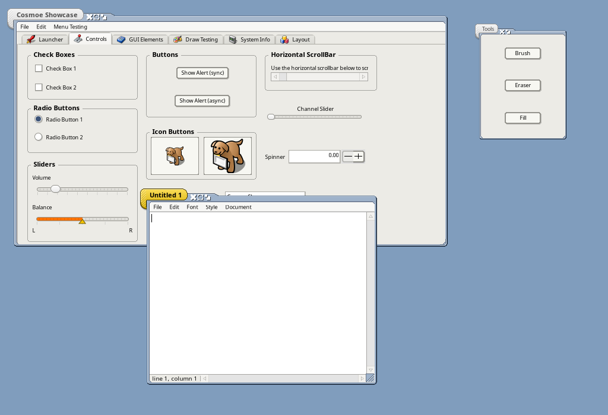

## Why this fork exists

- **AI-assisted fixes have a home here.** Each fix is reviewed and tested against real apps
  before it lands. Cosmoe doesn't accept AI contributions, so they live in this fork.
- **A library to build freestanding app ports against.** A stable Haiku API that Renku OS
  and Haiku apps build against to run on Linux as standalone programs (AppImages, say),
  behaving as closely to Haiku as possible.
- **In the spirit of [Renku](https://github.com/RenkuOS/Source)**, the Haiku fork that
  welcomes machine-assisted work.

Hokku follows upstream Cosmoe and merges its changes regularly. The library names, headers
and build (`meson`, `libbe.so` and friends) are unchanged, so anything that builds against
Cosmoe builds against Hokku. Licence: MIT, as upstream (see License.md).

## Highlights

- **Haiku apps build as they are.** Shared areas between processes, fair semaphores, a
  working node monitor, `BGLView`, `BNetworkRoute`, the public `BAboutWindow`, and
  `-lmedia`/`-ltranslation`/`-lnetwork` for unchanged Haiku Makefiles.
- **Drawing like app_server.** Pixel-exact lines and polygons, Haiku's transfer modes and
  bitmap transparency, underline and strikeout, rotated text, and fonts chosen as Haiku
  chooses them.
- **The desktop's tray icons in the Deskbar.** KDE, Qt, GTK and Electron apps' icons, with
  their menus, tooltips and live updates, next to Plasma's or Xfce's own tray or on their own.
- **More in the Deskbar.** A screen brightness control on laptops, a menu of the desktop's
  Linux applications, and shared recent documents, folders and apps.
- **Notifications, the Haiku way.** Haiku's `notification_server` and preferences, also
  showing other Linux apps' notifications, with action buttons.
- **Themes for the whole desktop.** Haiku's look or [Gonx](https://github.com/idumych/gonx)
  in one step: window frame, controls, colours, fonts, wallpaper, shadows and the BeOS
  pointer, carried over to GTK 3 and Qt apps too.
- **Wayland and touch.** Client-side Haiku and Gonx frames, menus the compositor places,
  corner panels, and touch screens (tap to click, long press for a right click).
- **A desktop session beside others.** "Hokku" on the login screen next to Plasma or GNOME,
  without cluttering their menus.


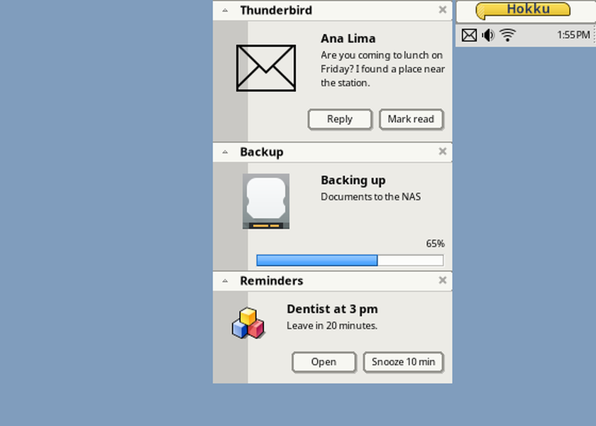

Haiku's look and Gonx on Hokku OS, applied to a Hokku app, a GTK 3 app and a Qt 6 app at
once:

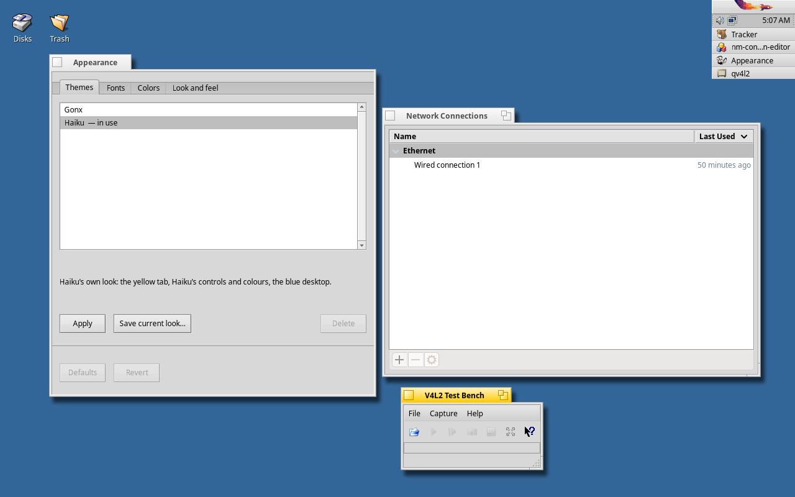

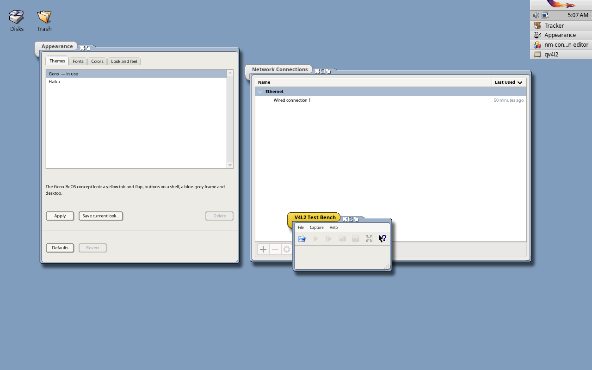

<details>
<summary>More screenshots</summary>

The Deskbar: a tray icon's menu sent over D-Bus, and the Linux applications menu.

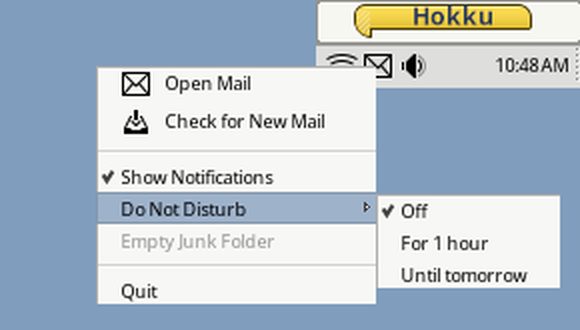

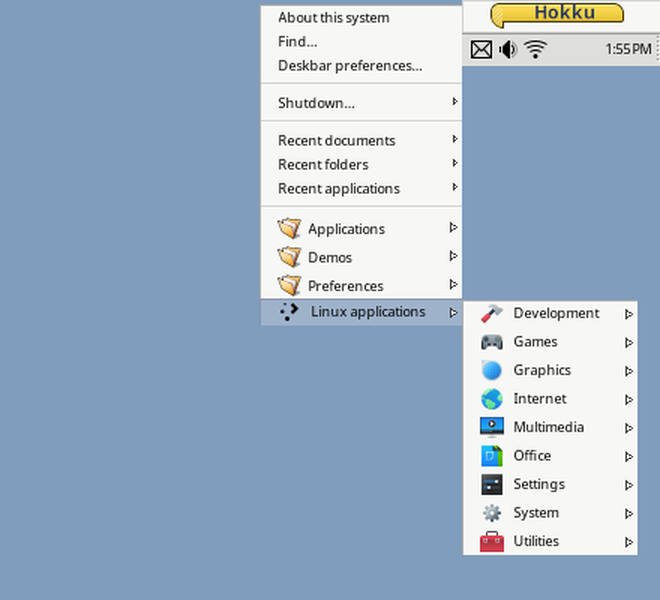

The Notifications preferences:

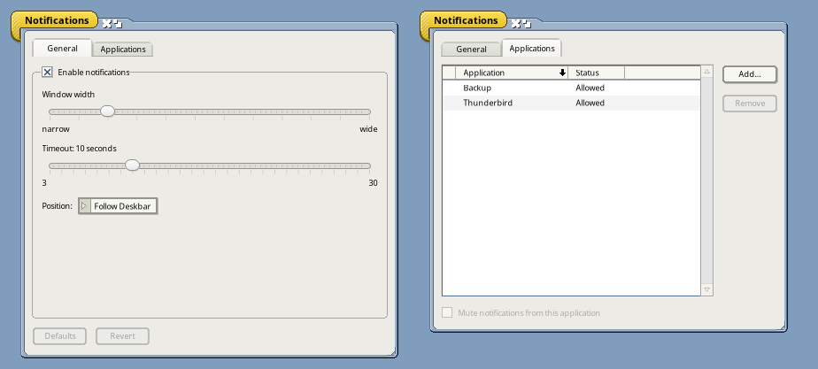

The same apps before and after `gonx-theme apply`, and Gonx close-ups: tabs, controls, a
menu and an alert.

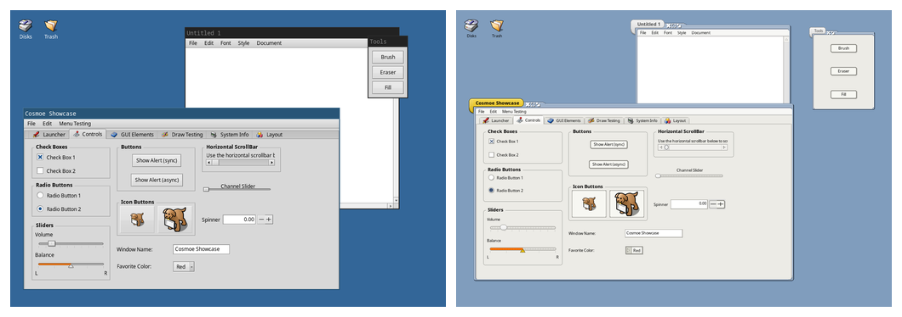

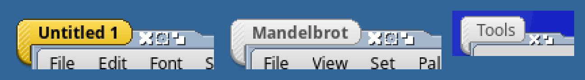

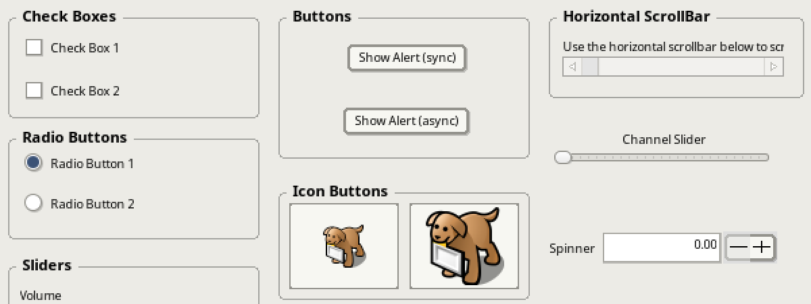

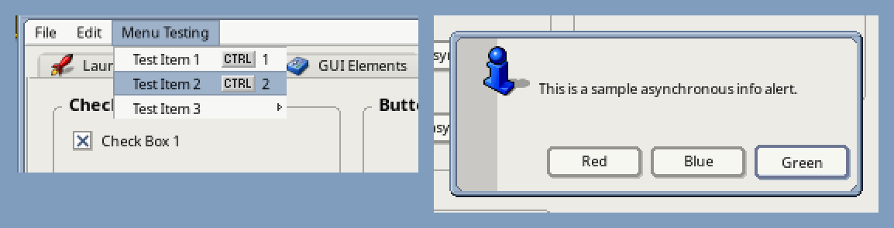

The Gonx controls in Hokku, GTK 3 and Qt (Kvantum):

| Hokku | GTK 3 | Qt (Kvantum) |
|---|---|---|
| 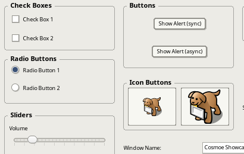 | 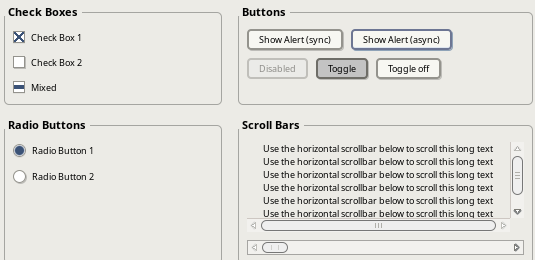 | 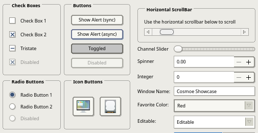 |

Haiku's window frame, AboutSystem, and GLTeapot through `BGLView`:

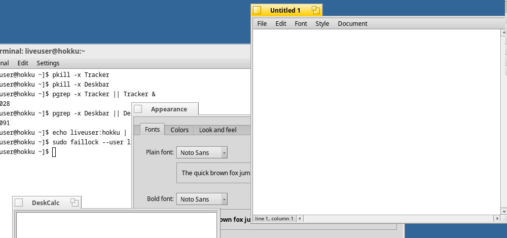

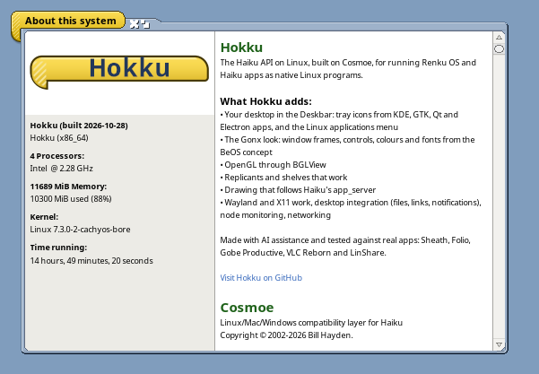

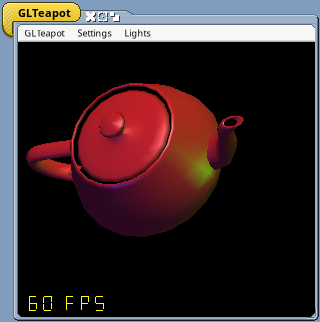

</details>

## Apps built on Hokku

Shipped on Linux with Hokku; each also runs on Renku OS and Haiku.

- [Sheath](https://github.com/idumych/sheath), a SWORD Bible reader (the first).
- [Folio](https://github.com/idumych/folio), a notebook with wiki links that follow renames.
- [Gobe Productive](https://github.com/idumych/gobe-productive), the BeOS office suite,
  ported from the original. The largest so far.
- [VLC Reborn](https://github.com/idumych/vlc-reborn), VLC media player with its BeOS
  interface back.
- [LinShare](https://github.com/idumych/linshare), atomozero's
  [HiShare](https://github.com/atomozero/HiShare) (the modernized BeShare file-sharing and
  chat client) for Linux.

Each brought fixes with it; they are listed under All changes from Cosmoe below.

## Building

Hokku's changes are made and tested on Linux. The macOS and Windows builds are upstream
Cosmoe's; the steps below are upstream's, and Hokku isn't tried on those systems.

### Linux

You need gcc or clang, meson and ninja, bison and flex, and the development files of
libpng, ICU, FreeType, Pango, fontconfig, GLib, Wayland, pixman, xkbcommon (with its X11
part) and cairo. libjpeg, libwebp, libtiff, libraw and libicns are optional; without them
the matching image translators aren't built. For SVG tray icons add librsvg, and for
`BGLView` EGL and the OpenGL headers.

Ubuntu and Debian:

```bash
sudo apt install gcc g++ flex bison libpng-dev libjpeg-dev libwebp-dev libtiff-dev libraw-dev libicns-dev libicu-dev libfreetype6-dev libpango1.0-dev libpixman-1-dev libxkbcommon-dev libwayland-dev pkg-config meson libxkbcommon-x11-dev libxcursor-dev libxrandr-dev libfuse3-dev libx11-xcb-dev librsvg2-dev libegl-dev libgl-dev
```

Fedora:

```bash
sudo dnf install gcc g++ flex bison libpng-devel libjpeg-devel libwebp-devel libtiff-devel libraw-devel libicns-devel libicu-devel freetype-devel pango-devel libxkbcommon-devel wayland-devel meson libxkbcommon-x11-devel libXcursor-devel libXrandr-devel fuse3-devel libX11-devel librsvg2-devel mesa-libEGL-devel mesa-libGL-devel
```

Arch Linux:

```bash
sudo pacman -S python meson pkg-config libwebp libtiff libraw libicns gcc binutils make flex bison librsvg
```

Then:

```bash
make
make install
```

The build goes into `builddir`, and programs are installed to `/usr/local/bin`. To bundle
Hokku with one app, leave the apps out (`meson setup builddir -Denable_apps=false`, or
`meson configure builddir -Denable_apps=false` on an existing build directory).
`packaging/appimage/build-appimage.sh APP` builds Hokku and packs one of its own apps as an
AppImage.

For the tray, `xembedsniproxy` (part of Plasma) or `snixembed` brings in XEmbed icons; both
are optional.

### macOS

Install the Xcode command line tools (`xcode-select --install`) and
[Homebrew](https://brew.sh/), then:

```bash
brew install meson ninja pkg-config cairo pango libpng jpeg-turbo webp icu4c freetype fontconfig glib
make
make install
```

The build needs a case-sensitive volume, so `make` creates a disk image and builds there
(you may see it mounted in the Finder). Command-line programs go to `/usr/local/bin`,
graphical programs to `/usr/local/Applications` and fonts to `~/Library/Fonts/Cosmoe`.

### Windows

The Windows version is cross-compiled on Linux or WSL with
[MXE](https://mxe.cc/), and runs on Windows or under Wine.

1. Install MXE's prerequisites (in WSL, also link `python`):

   ```bash
   sudo apt install automake autoconf libtool ruby unzip lzip gperf autopoint 7zip intltool libtool-bin python3-mako libssl-dev libpcre2-dev
   sudo ln -s /usr/bin/python3 /usr/local/bin/python
   ```

2. Get MXE and build the packages Hokku needs:

   ```bash
   git clone https://github.com/mxe/mxe.git ~/mxe
   cd ~/mxe
   make MXE_TARGETS=x86_64-w64-mingw32.shared \
        gcc cairo pango fontconfig freetype icu4c libpng jpeg libwebp
   ```

3. Build and install the Linux version first (`make`, `make install`): it provides some of
   the build tools.
4. Check that `cross-mxe.ini` has your MXE paths, then run `make windows`.
5. Apps aren't installed on Windows yet: `./collect-windows-binaries.sh` gathers the
   executables and DLLs into a test folder.

## Running the apps

Apps start from the command line or from your desktop's launcher. The build includes
Showcase (the testbed for new API work, and the best example of what the library can do),
AboutSystem, Terminal, StyledEdit, Mandelbrot, FontDemo, Gradients, Deskbar, Clock, Pulse,
ShowImage, DeskCalc, Pairs, DriveUsage, CharacterMap, Icon-O-Matic, Sudoku, GLTeapot (with
OpenGL) and Tracker. Not all of them behave exactly as on Haiku yet.

For a whole BeOS-style desktop (Tracker and Deskbar) without logging out, install labwc
and run `./start_cosmoe_desktop.sh`. The API reference is the
[Haiku Book](https://www.haiku-os.org/docs/api/) and the BeBook.

## Using it in your app

The app templates in [beos-app-platforms](https://github.com/idumych/beos-app-platforms)
build their AppImages (x86_64 and aarch64) against Hokku's `hokku` branch by default; an
app's `haiku-app.env` can point `COSMOE_REPO` and `COSMOE_TAG` at another fork or tag. CI
caches the build by the commit the branch points at, so a new Hokku commit is picked up on
the next build.

An app that also builds for Haiku puts Hokku-only calls (such as `BNotification`'s actions)
under `#ifdef APP_COSMOE`.

## Problems

Problems found with Hokku are fixed here, as new commits on `hokku`, with the smallest
program that shows the bug used to test the fix. Please don't report them to upstream
Cosmoe: it doesn't take AI-assisted work, and the bug may be one Hokku introduced or already
fixed.

## Thanks

To Bill Hayden and the Cosmoe contributors, who brought the Haiku API to other systems, and
to the Haiku project, whose work made both possible.

## All changes from Cosmoe

### The Deskbar and its tray

- **The desktop's tray icons.** On Linux the Deskbar starts `TrayBridge`
  (`src/apps/traybridge`), a StatusNotifierItem host that puts each of the desktop's tray
  icons in the tray as a replicant: KDE and Qt apps, GTK apps using libappindicator or
  libayatana-appindicator, Electron apps (Signal, Slack...), VPN clients, update notifiers.
  - A click activates the app, a middle click is its secondary action, the wheel scrolls,
    and a right click opens the app's own menu (`com.canonical.dbusmenu`) with icons,
    checkmarks, radio items, submenus and disabled entries. The app hears when the menu
    opens and closes.
  - Icon, attention, overlay, tooltip and status changes come in live. Passive icons are
    hidden, as Plasma hides them; `HOKKU_TRAY_SHOW_PASSIVE=1` shows them.
  - Icons come from the app's pixmaps or the icon theme (KDE's, GNOME's or GTK's setting,
    Breeze in an unchanged Plasma session, or `HOKKU_ICON_THEME`). SVG icons are drawn with
    librsvg when it's installed, and KDE's symbolic icons take the system colours.
  - On a desktop that already has a tray (Plasma, Xfce), TrayBridge registers with that
    desktop's StatusNotifierWatcher as one more host, so the icons are in both trays.
    Elsewhere it is the watcher.
  - Old XEmbed icons (Wine, older GTK 2 and Java apps) come through `xembedsniproxy` or
    `snixembed` when one is installed (`HOKKU_TRAY_XEMBED=0` to skip).
  - `HOKKU_TRAYBRIDGE=0` keeps it from starting. A restarted Deskbar finds TrayBridge
    running and gets its icons.
  - Tested in a Plasma 6 Wayland session, on X11 and on sway.
- **Screen brightness.** On a machine with a backlight, the tray has a brightness control
  (`src/apps/deskbar/BrightnessItem.cpp`): a click on the sun opens a slider, the wheel
  steps by 5%, and the tooltip tells the level. It sets the backlight through logind
  (`SetBrightness`, no root or udev rule needed), reads it from `/sys/class/backlight`
  preferring the firmware device as systemd does, and never goes below 1%.
- **Linux applications in the Deskbar menu.** Every `.desktop` file the desktop itself
  would show (honouring `NoDisplay`, `Hidden`, `OnlyShowIn`/`NotShowIn` and `TryExec`, your
  own overriding the system's), in submenus by freedesktop main category, with icons.
  Choosing one starts it through GIO. The list is read again when a folder changes.
- **A Gonx tab for the menu button** with the Gonx look, saying "Hokku", instead of the
  Cosmoe rocket.
- **The Deskbar menu is never empty.** It named its folder by an absolute path, so a moved
  or staged install (an AppImage) or a run from the build folder got a menu with nothing in
  it, not even About or Shutdown. A moved install now finds the menu beside
  `menu_entries`, and without one the menu shows its standard items and your own Deskbar
  folder.
- **The Deskbar drops apps that quit before it noticed their window** (the Terminal opened
  at login, say): when an app quits, it also drops listed processes that are gone.
- **Every app in the Deskbar has its icon.** When an entry gets no usable icon, the
  Deskbar fetches it again.
- **`BDeskbar::Frame()` answers.** It had been switched off because it could hang Tracker;
  it asks the Deskbar again, giving up after half a second.
- **`BDeskbar::AddItem()` returns Deskbar's error** instead of `B_NAME_NOT_FOUND`.

### Notifications

- **Haiku's `notification_server` and Notifications preferences.** The Deskbar starts it
  on Linux (`HOKKU_NOTIFICATIONS=0` leaves it off). Notifications are grouped by app beside
  the Deskbar, with icons, progress bars and the important type marked; they time out and
  update in place when sent again with the same ID.
- **`BNotification::Send()`** goes to it when it runs, and to the desktop's notifications
  (`notify-send`) when it doesn't. It used to run `system("notify-send ...")`, so quotes or
  `$(...)` in a title ran commands, and the window waited; now the text goes as arguments to
  a detached `notify-send` (`osascript` on macOS), never seen by a shell.
- **Action buttons.** A Hokku extension: `AddAction(label, message[, target])` adds a button
  that sends the message to the target (the app by default) and closes the notification;
  `CountActions()`, `ActionLabelAt()`, `ActionMessageAt()` and `ActionTargetAt()` read them.
  The class keeps its size. Renku OS has the same API
  ([RenkuOS/Source#233](https://github.com/RenkuOS/Source/pull/233)); Haiku doesn't.
- **The desktop's apps' notifications.** It serves `org.freedesktop.Notifications` when no
  other notification server does (under Plasma or GNOME their own popups keep them, until
  they stop). Icons, critical urgency, progress hints, replacement IDs, the default action,
  other actions as buttons (Reply, Mark read...) and close reasons all map across.
- **The preferences** set on/off, width, timeout and position, and mute any app; changes
  apply at once. Every app that sent one is listed, the desktop's apps too.

### Looks and themes

- **The Gonx look.** `gonx-theme apply` switches to the whole
  [Gonx](https://github.com/idumych/gonx) look and `gonx-theme revert` goes back.
  - Window frame: titled, document and floating windows get the Gonx tab, flap and rounded
    corners on Wayland, and modal windows (alerts) the Gonx border, moved by dragging it.
    The frame is client-side, so the compositor leaves its own title bar off. On X11 the
    window manager draws frames. `setdecor Gonx` and `setdecor Default` switch only the
    frame.
  - Controls: `GonxControlLook.so`, the same code as the Renku add-on; `setcontrollook`
    chooses it on its own.
  - Colours, fonts (Noto Sans at 9 and 11 points) and the desktop colour.
- **Haiku's window frame.** `setdecor Haiku` gives Hokku windows app_server's Default
  decorator on Wayland (the yellow tab, bevelled border, resize notches and a document
  window's knob), ported to cairo and drawn client-side. `Default` stays the desktop's own
  frames.
- **Document windows resize from the frame's knob** in the Gonx and Haiku frames; the
  content's widget used to take the pointer there.
- **Standalone apps keep the desktop's frames.** An app run from its AppImage takes the
  rest of the look but keeps the desktop's window frames (Hokku's default frame where the
  compositor draws none).
- **Themes.** Appearance has a Themes tab, and `hokku-theme` does the same from a shell
  (`list`, `apply NAME`, `save NAME`, `current`, `shadows on|off`). A theme sets:
  - the window decorator (Default, Haiku or Gonx) and the control look;
  - the system colours and the plain, bold, fixed and menu fonts;
  - the desktop colour and a wallpaper;
  - for other Linux apps: labwc's frames (a themerc written to
    `~/.config/labwc/themerc-override`, yours kept as `.orig`; Haiku and Gonx name their
    frame with `window.decorator`, which
    [Hokku OS's labwc](https://github.com/idumych/hokku-os/tree/main/packages/labwc-hokku)
    draws with Hokku's own frame code), the GTK, icon and cursor themes, GTK's font, and the
    Qt style (qt5ct, qt6ct, Kvantum).

  Hokku ships Haiku and Gonx in `/usr/share/cosmoe/themes`; *Save current look* keeps yours
  in `~/.config/cosmoe/themes` (a folder with a `theme.ini`, see
  `src/preferences/appearance/Theme.h`). Running apps take new colours, fonts and frames; a
  new control look shows when they restart.
- **Haiku and Gonx for GTK 3 and Qt.** GTK themes in `/usr/share/themes` and Kvantum themes
  for Qt 5 and 6 in `/usr/share/Kvantum`, generated (`data/linux/gtk/generate.py`,
  `data/linux/kvantum/generate.py`) from the control looks' own colours and shapes. The
  Hokku session hands Qt apps the theme's style and GTK's font and icons
  (`QT_STYLE_OVERRIDE`, `QT_QPA_PLATFORMTHEME=gtk3`) and keeps GTK's scroll bars beside the
  content (`GTK_OVERLAY_SCROLLING=0`). GTK 4/libadwaita apps keep their own look.
- **Window shadows and BeOS's pointer.** Windows in the Haiku and Gonx frames cast a soft
  shadow (`gonx_frame_paint_shadow()`; Hokku OS's labwc draws the same under other apps'
  windows). The pointer is BeOS's hand and I-beam, as the Xcursor themes `Hokku` and
  `Hokku-Shadow` (`data/linux/cursors/generate.py`). Appearance's *Look and feel* tab turns
  window and pointer shadows on and off together. Hokku apps ask the compositor for their
  standard cursors (cursor-shape protocol), following its cursor theme.
- **System colours, fonts and the desktop colour are kept.** `set_ui_color()`,
  `set_ui_colors()` and `BScreen::SetDesktopColor()` did nothing, `ui_color()` always gave
  the built-in colours, and the fonts saved by Appearance were replaced by the defaults when
  an app started. They are now saved and used by apps started afterwards. A dark control
  look still brings its own colours. `_set_system_font_()`, Haiku's private call for
  Appearance and theme tools, exists. Apps no longer print `ControlLook add-on loaded
  from ...`.
- **About this system says Hokku**, with what Hokku adds, a large Gonx badge
  (`src/apps/deskbar/gonx-logo.py`), Cosmoe and Haiku credited, and the Linux kernel's
  release where the kernel's build date was.

### Drawing

- **Font styles chosen like Haiku.** Styles lighter than Book get `B_LIGHT_FACE`, Black and
  Heavy get `B_HEAVY_FACE`, condensed widths `B_CONDENSED_FACE`, and when several styles share
  a face the canonical one wins. Before, every weight below Bold counted as regular and the
  first match was used, so `SetFamilyAndFace("Noto Serif", B_REGULAR_FACE)` drew Thin.
- **Underline and strikeout are drawn.** `B_UNDERSCORE_FACE` and `B_STRIKEOUT_FACE` stay in
  the font's face and are drawn by `DrawString()`, so `BTextView` runs show them.
- **Rotated text turns about its pen location**, as in app_server. The rotation was applied
  about the view's origin, so rotated text landed away from where it was drawn (a vertical
  ruler's numbers fell outside its view).
- **Views moved by a layout are redrawn whole.** A layout pass could move children between
  `Invalidate()` and the update, leaving half-drawn buttons and remnants of earlier frames.
  The update now takes the children from their current frames.
- **A resize can't leave a window's last drawing off screen.** On X11 the backend's redraw
  for a resize could run before the new backing surface existed, so the window showed its
  earlier content until something else drew. The window now asks for a redraw when the
  surface changes.
- **The text caret blinks under the backing-surface lock.** `InvertRect()` drew without the
  lock the backend holds while copying to the screen, so a copy could catch the inversion
  halfway.
- **`B_OP_MIN` and `B_OP_MAX` compare brightness**, as app_server does. Cairo's DARKEN and
  LIGHTEN compare each channel on its own, so a gray wash over a red icon (how many BeOS
  apps grey out a disabled button) gave pink.
- **Lines, rects and polygons sit on the pixels app_server uses.** Unless a view is
  `B_SUBPIXEL_PRECISE`, coordinates are rounded down to whole pixels; an even pen size is
  centred on the pixel edge, so a line of pen size 2 covers two rows instead of a blurred
  three; thick lines get butt caps; a filled polygon's points are pixel corners, and
  triangles go through pixel centres.
- **Patterns leave their low color out in `B_OP_OVER`.** Transparent pattern pixels kept
  their color without alpha, which Cairo (premultiplied) added to what was underneath: a
  stipple over text painted the low color between its dots.
- **8-bit and 32-bit bitmaps are transparent where Haiku's are.** Outside `B_OP_COPY`,
  `B_TRANSPARENT_MAGIC_CMAP8` and `B_TRANSPARENT_MAGIC_RGBA32` pixels are left out, and
  `B_OP_ALPHA` uses a `B_RGB32` bitmap's alpha. Icons drawn with `B_OP_OVER` showed a white
  box before.
- **A view bitmap's `Bits()` and its views' drawing stay in step.** On Haiku they are the
  same memory; here they are two copies, and pixels written through `Bits()` were lost
  unless the app locked the bitmap in between. The bitmap now tracks which copy changed.
  Test: `src/tests/kits/interface/bbitmap/BitmapBitsSyncTest`.
- **Rect tracking's outline is on the screen.** `BeginRectTracking()` drew into the
  window, so the outline vanished once the pointer left it (a menu torn off into a floater).
  On X11 it is now drawn over everything, as app_server does; Wayland keeps drawing it in
  the window. It also starts from where the pointer is now, not where it was pressed.
- **A removed view is repainted over.** Nothing redrew the area a view left when it was
  removed, so it stayed on screen; `BView::RemoveChild()` now invalidates it.

### OpenGL

- **`BGLView`** (`libopengl.so`, `<opengl/GLView.h>`, Haiku's API): `LockGL()`,
  `UnlockGL()`, `SwapBuffers()` and `GetGLProcAddress()` from any thread. It renders with
  EGL (Mesa's surfaceless platform when there is one, otherwise the default display, so
  NVIDIA's driver works too) into an off-screen buffer that the view draws, on X11 and
  Wayland alike. It's built when EGL and `GL/gl.h` are found. `DirectConnected()` and
  `EnableDirectMode()` exist and do nothing; `CopyPixelsIn()`/`Out()`, overlays and
  `BGLScreen` aren't there yet. `SwapBuffers()` posts the frame to the window rather than
  locking it, so pointer motion no longer drops GLTeapot from about 700 frames per second
  to 9-80.
- **GLTeapot**, Haiku's OpenGL demo, is included (Deskbar: Demos).
- **`BScreen::WaitForRetrace()`** waits for the next tick of a 60 Hz clock, since the
  display server doesn't tell apps when the screen refreshes.

### Windows, menus and input

- **New windows open at their frame's position**, as app_server places them. They were
  left where the window manager put them (a pop-up slider meant for its control came up
  in the screen's corner).
- **Popup windows.** A `kMenuWindowFeel` window with `kWindowPopupGrabFlag`, made a popup
  of its parent with `BPrivate::set_popup_window_parent()` (`WindowPrivate.h`), opens
  beside the parent, takes the pointer and keyboard (an `xdg_popup` grab on Wayland), and
  is sent `B_QUIT_REQUESTED` when the user clicks elsewhere. On X11 it isn't grabbed.
- **Pop-up menus stay open after the press that opened them**, and Escape or a click
  outside closes them. A `BPopUpMenu::Go()` on the window's own thread blocks that window,
  so its press, release and Escape never reached the menu; they are now counted as they
  arrive from the backend. A right click's context menu no longer chooses the first item
  the pointer crosses.
- **X11: a deactivated pop-up stays up.** Menus are deactivated as they open, which lowered
  them under the window they pop up from.
- **`GetMouse()` reports the buttons as they are now**, even while the window is busy: a
  view tracking the mouse in `MouseDown()` never saw the button come up and looped forever.
  Presses and releases also update the position it falls back on, so the first click after
  entering a window counts where it happened.
- **App-wide pointer events.** Views that call `SetEventMask(B_POINTER_EVENTS)` get every
  pointer motion, in whatever window they live, as on Haiku. Tooltips rely on this to close
  when the mouse moves; before, they stayed on screen for good. Events go to the listening
  view itself, without holding a lock while sending, and a busy window drops them rather
  than blocking the display thread.
- **Leaving a window is a `B_EXITED_VIEW`**, so a tooltip shown for a view doesn't stay
  after the pointer moves to another window.
- **Pointer events don't walk an unlocked window.** The display thread looked up the view
  under the pointer without the window's lock. It now takes the lock only if it is free;
  otherwise the window thread finds the view itself. A modal `BAlert::Go()` can't deadlock
  against it.
- **Opening a menu doesn't read the menu bar unlocked**, and a menu that fills slowly (the
  Deskbar's, on a cold machine) locks its parent before asking where the mouse is. Both
  printed "Looper must be locked".
- **Shortcut characters fit in menus.** Wide ones (W, M) were cut off at the right edge.
- **Very short clicks no longer freeze a window.** Deleting a `BMessageRunner` right after
  creating it deadlocked its looper, and `BTextView` does exactly that on a zero-length
  click (touchpad tap, xdotool, remote desktop).
- **A keymap without a configured layout.** With no layout set and no `setxkbmap` (a
  Wayland-only system), `get_key_map()` failed and Tracker crashed on startup. It builds
  the keymap from xkbcommon's defaults (`XKB_DEFAULT_*`, else us).

### Wayland and touch

- **Touch screens work.** The first finger on a window drives the mouse, as a tablet does
  on Haiku: a tap is a left click, a moving finger drags, and one held still for 0.6
  seconds is a right click. Dragged from a menu into a submenu, it reaches the submenu where
  the compositor really put it; a mouse drag does the same. Tapping or releasing on an item
  with a submenu opens the submenu, as on Haiku. `HOKKU_TOUCH_DEBUG=1` prints what touch and
  the pointer do. Tested with KWin's fake input and on a touch screen in Plasma.
- **Menus are placed by the compositor**, which may flip, slide and resize them. `BMenu`'s
  own placement, with no real window positions, put a `BMenuField`'s pop-up off screen on a
  second monitor.
- **A panel can sit away from its corner.** A layer-shell surface with the private
  `kWindowPanelOffsetFlag` turns `MoveTo()` into margins from its corner, so the
  notification window sits beside the Deskbar. The margins follow the panel as it grows.
- **Panels have no window frame**, so the notifications aren't cut off or framed.
- **Window frames in an AppImage.** The frame's images are found in the data folder next to
  libbe, so a relocated copy draws its client-side frame.
- **The desktop and the Deskbar come back after a text console.** labwc removes the outputs
  while a text console has the screen, and layer surfaces went with them. They are made
  again when an output appears, including for a Deskbar started meanwhile, and
  `BScreen::Frame()` is the last screen rather than empty, so Tracker no longer piles the
  desktop icons at 0,0.
- **No crash when a frameless window's view is replaced.** The window's surface kept
  pointing at the freed root widget (an alert's top view) and a queued resize used it.

### Desktop integration

- **Hokku next to another desktop.** Installed beside Plasma, GNOME or another desktop,
  Hokku is one more choice on the login screen. The other desktop's menus don't list
  Hokku's own desktop parts (`OnlyShowIn=cosmoe`), while Hokku's apps stay listed and claim
  no file types. The session takes the system keyboard layout (from `localectl`,
  `/etc/default/keyboard` or `/etc/vconsole.conf`), and `cosmoe-portals.conf` picks portal
  backends: wlroots' for screenshots and screen sharing, GTK's or KDE's for the rest.
- **The desktop session on Arch, and on real GPUs.** `cosmoe-desktop.sh` builds the first
  login's MIME database from pacman packages too, not only dpkg and rpm, and from their
  files only (scanning `/usr` took minutes), layered over the system database. It finds
  polkit-gnome's agent on Arch and Fedora, starts mako only when Hokku's notifications are
  off, and uses the pixman renderer and software cursors only under VirtualBox.
- **`BRoster::Launch()` opens files, folders and URLs with the desktop.** When no Cosmoe app
  handles a document, URL or `be:url`, it runs `xdg-open`, detached, without the variables
  an AppImage's AppRun set.
- **Launched apps aren't left as zombies.** Apps are started detached, so nothing has to
  wait for them, as on Haiku.
- **Apps without windows are seen.** `BRoster::GetAppInfo()`, `IsRunning()` and
  `GetAppList()` find running apps that have no window, and `BMessenger::IsValid()` is true
  for a messenger into another running app, so `hey` reaches the Deskbar, Tracker's desktop
  and the servers (`hey Deskbar BeMn` opens the Deskbar menu). `GetAppList()` lists each app
  once, by its real team.
- **Recent documents, folders and apps are shared**, as Haiku's registrar keeps them, in
  `~/.config/cosmoe/roster/recent_documents`, `recent_folders` and `recent_apps` (one
  `signature<TAB>path` per line, newest first), and survive a restart. Background apps,
  Tracker, the Deskbar and command line tools aren't recent apps.
- **`BShelf` works again.** Cosmoe had replaced it with stubs (`AddReplicant()` always
  failed), likely because `<AutoLock.h>` collides with `<Autolock.h>` on macOS's
  case-insensitive file system. Haiku's implementation is back, using `<AutoLocker.h>`.
- **`BScreen::GetBitmap()` and `ReadBitmap()`** copy the screen into a `B_RGB32` bitmap on
  X11 (Wayland doesn't let clients read the screen: `B_UNSUPPORTED`). `BScreen::Frame()`
  ends on the last pixel, as on Haiku.

### Kernel, files, storage and network

- **Areas are shared between processes on Linux.** Each area is a POSIX shared memory
  object in a registry all of a user's processes share (`/hokku-areas-<uid>`). As on Haiku,
  area IDs are unique across teams, `find_area()` and `get_area_info()` see every team's
  areas, `clone_area()` maps the same pages, protections are enforced, and a team's areas
  are freed when it exits, or by the next team after a crash. `_kern_transfer_area()`
  returns the area's ID, so `BMessage`'s pass-by-area works. macOS and Windows keep
  per-process areas. Test: `area_shared_test`.
- **Semaphores are fair, as on Haiku.** POSIX semaphores don't queue their waiters, so a
  looper releasing and reacquiring its lock between messages starved other threads (up to
  81 ms, 0.3 ms now). Each semaphore is now a count and a queue. Also: `B_ABSOLUTE_TIMEOUT`
  isn't read as wall-clock time, `delete_sem()` wakes its waiters, `B_RELEASE_ALL` and
  `B_RELEASE_IF_WAITING_ONLY` work, and a killed thread leaves the queue.
- **Every thread has its own ID.** `find_thread(NULL)` gave `B_NAME_NOT_FOUND` for threads
  not started by `spawn_thread()` (a `BMessageRunner`'s), so they shared one ID and a
  `BLocker` took one's lock as another's. A window's message queue broke and the Terminal
  stopped showing what was typed.
- **`watch_node()` works.** It finds a path for the node (an existing watch, or a node the
  app has open) and watches that. Node monitor messages carry `device`/`node`/`directory`
  as int32/int64 like Haiku's, and either getter reads either field.
- **Node monitor code compiles unchanged.** `BMessage` has `FindInt64("node", &ref.node)`
  and `FindInt32("device", &ref.device)` overloads for Linux's `ino_t` and `dev_t`, and
  `BDirectory(const node_ref*)` and `SetTo(const node_ref*)` exist.
- **Opening a file is not a change.** Closing a file without writing sent
  `B_STAT_CHANGED`, so StyledEdit said files "were modified by another application".
- **Closing a directory no longer leaks a descriptor.** One leaked per `BDirectory` or
  `BEntry`; the Deskbar leaked about ten each time its menu opened, until its menu came up
  empty. `BDirectory` also no longer closes its descriptor twice.
- **`entry_ref::name` is a full path**, as in Cosmoe (Linux can't find a directory from its
  node). File panel titles and Open With show the leaf name. In app code, use
  `BPath(&ref).Leaf()` or `BEntry::GetName()`, which are portable to Haiku.
- **Translators.** `TRANSLATORS=/a:/b` no longer drops a character from each entry; a user
  translator hides the system one of the same name; if none load, the directories searched
  are printed. `BDirectory::GetNextRef()` reports errors and fills in the parent's device
  and node.
- **`BNetworkRoute` works on Linux**, reading `/proc/net/route` and `/proc/net/ipv6_route`;
  `GetDefaultRoute()`/`GetDefaultGateway()` return the default route with the lowest
  metric. `BNetworkInterface` and `BNetworkRoster` aren't there yet.

### Logs and debugging

- **Quiet logs.** `system_beep()` no longer writes a bell and `beep event ...` to standard
  output, and the resource reader no longer prints `read_exactly: ...` and `InitContainer:
  Caught Exception` for files without resources.
- **`debugger()` and the `<Debug.h>` helpers say something.** `debugger()` messages go to
  standard error with a backtrace (Haiku would stop the app in its debugger).
  `_debuggerAssert()`, `_debugPrintf()`, `_sPrintf()` and `_setDebugFlag()`, which old Be
  code calls directly, exist.

### Build and install

- **Haiku Makefiles link unchanged.** `libmedia`, `libtranslation` and `libnetwork` are
  installed as linker scripts that link libbe, where those kits live here.
- **`BAboutWindow` is public**, in `headers/os/interface` and `InterfaceKit.h`, as in Renku;
  `<private/interface/AboutWindow.h>` still works.
- **Smaller AppImages: a build without the apps.** `-Denable_apps=false` leaves out
  `src/apps` and `src/preferences`, so an app bundling Hokku doesn't carry Tracker and the
  rest.
- **AppImages of Hokku's own apps.** `packaging/appimage/build-appimage.sh APP` packs an app
  with what it links, both display backends, its catalog and the Noto fonts. CI builds
  GLTeapot this way for x86_64 and aarch64 and starts it under X11 and Wayland.
- **Installing.** The Wayland session file goes inside the prefix unless it is `/usr` or
  `/usr/local`, so non-root installs finish. Staged (`DESTDIR`) installs no longer delete
  `libbe.so` from the build machine, and apps' MIME entries record where they're installed,
  not their staging path.
- **Installed apps are typed as apps.** The system MIME database is installed before the
  apps, so `mimeset` no longer types them `application/octet-stream` in a package build.
- **Installs and types apps on ext4.** ext4 keeps at most 4 KiB of attributes per file, and
  `mimeset` failed on Tracker, Chart and Showcase, stopping `meson install` on Ubuntu and
  Debian. An attribute that doesn't fit is now left out; `BAppFileInfo` reads it from the
  resources instead.
- **CI runs the kernel and unit tests.** The kernel tests had all been skipped, since the
  downloaded build lost its executable bits.
